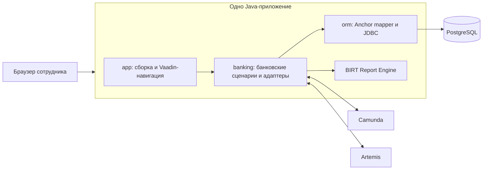

# Архитектура учебного банка

Дата исходной фиксации: 11 ноября 2026 года. Статус: исходная архитектура для
учебной реализации. Конкретные Java API, SQL и версии уточняются в учебных задачах.

Архитектурный образец —
[модульный монолит Finance Lab](https://github.com/finance-lab-project/app/blob/main/docs/architecture.md).
Его бизнес-правила, модель единственной учётной записи и облачная конфигурация
не становятся требованиями учебного банка.

## 1. Граница системы

Одно приложение на Java/Vaadin обслуживает интерфейс сотрудника и выполняет
банковские сценарии. Оно собирается в WAR и запускается на Jetty без Spring.
PostgreSQL хранит банковские данные. Camunda и Artemis запускаются как отдельные
среды исполнения; BIRT Report Engine используется внутри Java-приложения.



Vaadin вызывает прикладные сервисы обычными Java-вызовами. Внутренние вызовы
не требуют отдельного HTTP API. Отдельные репозитории сохраняют один процесс
приложения и общую сборку выпуска.

## 2. Репозитории и ответственность

| Репозиторий | Владеет | Результат сборки |
| --- | --- | --- |
| `app` | Канонической документацией, Maven parent, сборкой приложения, конфигурацией, маршрутизацией, входом, связыванием компонентов и жизненным циклом ресурсов | Parent POM и WAR |
| `banking` | Доменом, командами и запросами, авторизацией сценариев, Vaadin-компонентами, отображением данных, SQL-миграциями, отчётами, процессом и адаптерами сообщений | JAR |
| `orm` | Метаданными Anchor-модели, параметризованным SQL, JDBC-преобразованиями, выполнением транзакций и проекциями | JAR |

`app` зависит от выбранных версий `banking` и `orm`; `banking` использует `orm`
в адаптере хранения. Библиотеки не зависят от WAR. Maven parent содержит общие
правила сборки; зависимости приложения задаются в его сборке.

Для локальной разработки библиотеки можно устанавливать в локальный Maven-репозиторий.
Проверка общей сборки использует точные версии библиотек. Для демонстрационного
выпуска фиксируются версии и исходные коммиты. Реестр артефактов ещё не выбран.

## 3. Внутренняя структура banking

Концептуальная структура; точные имена пакетов выбираются при реализации:

```text
api/                   команды, запросы и DTO публичного интерфейса
domain/                бизнес-значения, сущности и правила
application/           прикладные сценарии и порты
adapter/ui/            Vaadin-компоненты
adapter/persistence/   репозитории, mappings и разрешённый специальный SQL
adapter/workflow/      взаимодействие с Camunda
adapter/messaging/     взаимодействие с Artemis
adapter/report/        подготовка и визуализация отчётов BIRT
resources/db/          миграции Flyway
```

Пакеты и адаптеры создаются вместе с использующим их сценарием.

- `domain` зависит от JDK и не содержит Vaadin, JDBC или ORM-аннотаций.
- `api` передаёт бизнес-команды и DTO, без соединений и ORM-сессий.
- `application` задаёт сценарии, проверки полномочий и границы атомарных операций.
- Адаптер хранения реализует порты, использует ORM и задаёт банковский протокол
  блокировок, версий и записи изменений.
- UI не открывает соединения и не управляет транзакциями.
- `app` явно создаёт компоненты и связывает их. Пул соединений, клиенты интеграций
  и их остановка принадлежат корню приложения.

Пользовательский контекст берётся из доверенной серверной интеграции входа.
Роли и полномочия определяются в P0-01 и реализуются в P3-02.

## 4. Anchor Modeling и небольшой ORM

Учебный профиль использует anchors, attributes, ties и knots. Отдельные Java-описания
отображения принадлежат `banking`; доменные классы от них независимы.

Минимальный целевой объём ORM:

1. Параметризованные вставки и чтение anchors, статических атрибутов и связей.
2. Работа с согласованными значениями knots.
3. Добавление историзируемых атрибутов и проекции `current`, `asOf`, `history`.
4. Точные JDBC-преобразования используемых типов, включая деньги и время.
5. Ограниченная временем callback сессия на одном соединении и явное выполнение
   транзакции с commit/rollback и освобождением ресурсов.

Начальная история имеет одну временную координату: когда изменение записано.
Дата банковской операции остаётся самостоятельным предметным значением.
Введение заднего числа, исправления истории или второго измерения времени
потребует отдельного решения.

ORM расширяется по потребностям текущего сценария. Универсальный язык запросов,
совместимость с JPA, lazy loading, автоматические каскады и генерация схемы при
старте не входят в исходную реализацию. Сложный запрос можно явно реализовать
в адаптере хранения на том же соединении.

Миграции Flyway — источник схемы PostgreSQL. ORM использует отображение,
проверяемое на соответствие миграциям, и не меняет схему самостоятельно.
Бизнес-версии, ревизии, смысл равенства и время записи выбирает `banking`.

Ориентир для сравнения границ:
[контракт ORM Finance Lab](https://github.com/finance-lab-project/orm/blob/main/docs/api-contract.md).
Готовая библиотека Finance Lab не подключается вместо собственной реализации.

## 5. Транзакции и денежные операции

Каждая атомарная операция использует одно соединение и одну транзакцию.
Успешный прикладной результат возвращается после подтверждённого commit.
Ресурсы закрываются и при исключениях; повтор команды после неопределённого
результата не выполняется вслепую.

Многошаговое чтение текущего или исторического состояния получает согласованный
снимок: одним запросом либо в read-only транзакции `REPEATABLE READ`.
Готовые DTO покидают транзакцию; открытые курсоры и ленивые обращения в UI не уходят.
Конкретные уровни изоляции и блокировки записи выбираются вместе с инвариантами
соответствующего сценария и проверяются на PostgreSQL.

Перевод изменяет обе стороны денежной операции атомарно. На этапе переводов
определяются модель проводок, правила остатка, порядок блокировок и долговечная
идентичность команды. Проверяется одновременное расходование средств и повтор
той же команды. История атрибутов клиента не выполняет роль денежного журнала.

Во время редактирования формы, ожидания человека, обмена с Camunda/Artemis и
рендеринга PDF транзакция базы не удерживается.

## 6. Интеграции

### Camunda: открытие счёта

`banking` владеет BPMN-процессом, обработчиками и бизнес-состояниями счёта.
Camunda хранит состояние выполнения процесса. Работники процесса вызывают
прикладные сервисы банковского модуля. Повтор задания не создаёт второй счёт;
связь заявки с результатом и поведение при повторах проверяются явно.

### BIRT: выписка

Банковский модуль владеет шаблоном и разрешённой проекцией данных выписки.
Данные считываются согласованно; BIRT получает подготовленный набор данных.
PDF формируется после освобождения транзакции. Доступ сотрудника к запросу
и результату проверяется прикладным сценарием.

### Artemis: асинхронный запрос выписки

Банковский модуль определяет запрос, идентификатор, состояния задания и результат.
После внедрения асинхронности подтверждение принятого запроса должно переживать
перезапуск. Сохранение запроса и outbox-записи выполняется в одной транзакции;
публикация происходит после commit. Обработчик допускает повторную доставку
и связывает результат с идентификатором запроса.

Outbox и защита обработчика от повторов вводятся на этапе Artemis.
Распределённая транзакция между PostgreSQL, Camunda и Artemis не используется.
Общий жизненный цикл клиентов принадлежит `app`; контракты и обработчики — `banking`.

## 7. Совместимость и доказательства

Версии Java, Vaadin, Jetty, PostgreSQL, Flyway, BIRT и клиентов интеграций выбираются
и фиксируются после небольших проверок совместимости. В этом документе нет
непроверенных утверждений о совместимости конкретных версий.

Каждый этап добавляет доказательство: работающий сценарий, соответствующие тесты,
проверенный запуск или наблюдение. Производительность оценивается измерениями
на описанной среде. Схема Anchor сама по себе не является доказательством
преимущества производительности.
